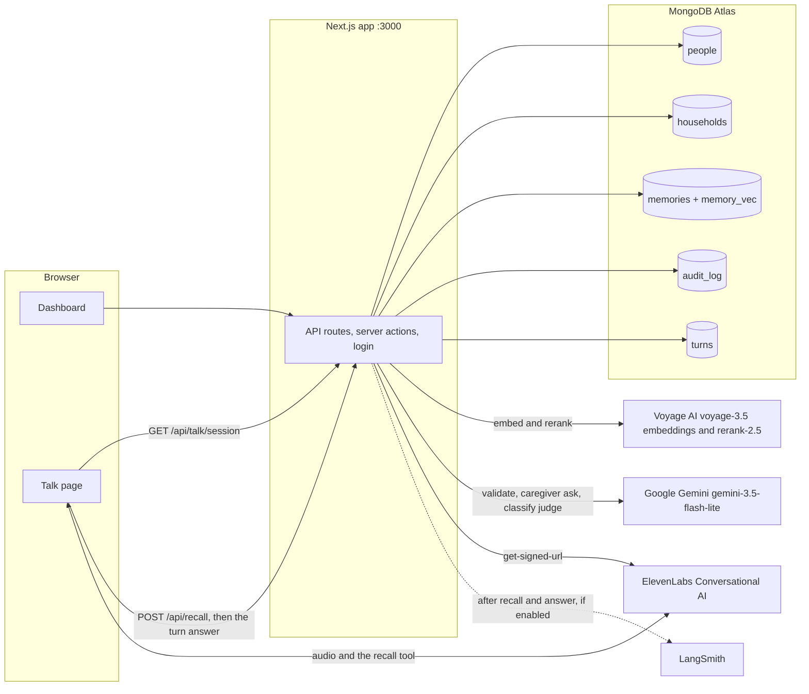

# Keepsake

Family-governed memory for a person with early dementia. A voice agent answers from memories that family can verify, correct, scope and supersede.

Built for the [Memory You Can Govern](https://cerebralvalley.ai/e/mongodb-toronto-hackathon/details) track at [Agents in Context Toronto](https://cerebralvalley.ai/e/mongodb-toronto-hackathon) (MongoDB, 14 Nov 2026). The official track brief is quoted in [docs/demo.md](docs/demo.md).

## Project Description

People with early dementia often lose recent events first: who is coming, what was already said, what changed. An agent that stores whatever it hears and repeats it back can make that worse.

Keepsake is a voice agent for the person, plus a family review screen. Family own the memory. They verify new notes, correct or forget wrong ones, set scope (`family` or `caregiver`), and confirm when a new note should supersede an old one. The person talks to the agent by voice (ElevenLabs). The agent answers only from verified memories, so a correction changes the next answer.

A caregiver can add a shift note. It stays unverified until family review, and the caregiver only sees caregiver-scope memories.

The demo household is invented: Margaret (person), Anna (family, admin), David (family), Ravi (caregiver). The app is not hardcoded to those names.

## Features

- Family verify, deny, correct and forget memories
- Scope rules: family read `family` and `caregiver`; caregivers read `caregiver` only; the person gets those verified memories through the voice agent
- Supersede proposals when a new note replaces an old one (rerank cutoff, time-stripped rerank for reschedules, and a Gemini judge for contradictions the score misses, such as "has no grandkids" vs "has two grandchildren")
- Voice recall: ElevenLabs calls `POST /api/recall`, which searches verified memories only
- Caregiver briefing and an "Ask about" box, both limited to caregiver scope
- Trace screen (`/trace`) showing the question, the answer, and the memory ids behind it

Expiry is not built. Time-bound facts keep dates in the text and on optional `event_start` / `event_end` fields. Recall does not filter on those dates.

## Use of MongoDB Products

- **MongoDB Atlas** is the store. Collections: `memories`, `people` (login only), `households` (roles and membership), `audit_log`, and `turns` (one doc per recall, read by `/trace`). Schema validation (`$jsonSchema`) is on those collections (`db/schema.js` and migrations).
- **Atlas Vector Search.** Writes and reads run `$vectorSearch` on the `memory_vec` index (`memories.embedding`, 1024 dims, cosine). The index has filter fields `person_id`, `status` and `scope`. Every search pre-filters to that person, `status: verified`, and the scopes the caller's role may see, so one household's memory does not leak into another.
- **Voyage AI** (MongoDB's embedding and rerank models). The app calls `voyage-3.5` to embed notes (`input_type: document`) and questions (`input_type: query`), stores the vectors on the memory docs, and calls `rerank-2.5` after the vector search.
- **BSON Date.** When a note names a day or time, validate writes `event_start` and optional `event_end` as BSON Date (`db/schema.js`). Those dates feed the time-stripped supersede check and the caregiver briefing. There is no TTL index and no `expires_at` write path (dropped in migration `004`).
- **Transactions and indexes.** Confirm, deny and correct use `session.withTransaction` so the new memory, the old status and the audit row change together. Regular indexes cover review queues, unique `people` emails and `user_id`s, unique `households.person_id` and `members.user_id`, `audit_log` by memory, and `turns` by `{person_id, at}`.
- We do not use change streams or Atlas Search / `$rankFusion` in this build.

## Architecture

The Next.js app is the only service. Login, writes, recall and traces all run there.



The read and write flow, including embedding and reranking, is in [docs/architecture.md](docs/architecture.md).

## How it works

**Flow 1: write.** Family or a caregiver adds a note (`POST /api/memories`). Gemini splits facts and resolves dates. Each fact is embedded with `voyage-3.5`, searched with `$vectorSearch` on `memory_vec`, and reranked with `rerank-2.5`. A candidate is proposed as a supersede if the plain score is at least 0.8, or a time-stripped rerank scores at least 0.55 and the time differs, or the Gemini judge flags a contradiction (on by default; it only adds, never removes; floor 0.5 on `main`). Family confirm before a supersede is saved. A caregiver note is always saved unverified for review.

Rerank scores relevance, not contradiction. A Leo 7pm reschedule scored 0.785 plain and 0.818 with times stripped. "Has no grandkids" vs "has two grandchildren" scored 0.648, under 0.8, so the judge has to catch it. A later change on `fix/classify-contradiction` (`ce2e0f8`) lowers that floor to 0.4 and counts implied contradictions such as "has no kids". That is not on `main` yet.

**Flow 2: read.** The person asks by voice. ElevenLabs calls `POST /api/recall` (the caregiver "Ask about" box uses the same route). The question is embedded as a query, searched with `$vectorSearch` (verified only, scoped by role), and reranked; hits below 0.5 are dropped. The agent answers only from that list. The turn, including cited memory ids, is written to `turns`.

## Tech stack

| Piece | Use |
|---|---|
| MongoDB Atlas | Document store, schema validation, transactions, indexes |
| Atlas Vector Search | `$vectorSearch` on `memory_vec`, filtered by person, status and scope |
| Voyage AI | `voyage-3.5` embeddings, `rerank-2.5` |
| Google Gemini | `gemini-3.5-flash-lite`: validate dates, caregiver answers, classify judge |
| ElevenLabs Conversational AI | Voice in and out; `recall` tool |
| LangSmith | Optional traces and recall evals |
| Next.js | UI, login, and all API routes (the old Fastify user service is gone) |

## Run locally

```bash
cd client
cp .env.example .env   # fill in keys; never commit .env
npm install
node --env-file=.env scripts/setup-vectors.mjs   # vector index + missing embeddings
npm run dev
```

Env vars (names only; values stay in `.env`): `MONGODB_URI`, `MONGODB_DB`, `VOYAGE_API_KEY`, `AUTH_SECRET`, `GEMINI_API_KEY`, plus `ELEVENLABS_API_KEY` and `ELEVENLABS_AGENT_ID` for voice, and optional `LANGSMITH_TRACING`, `LANGSMITH_API_KEY`, `LANGSMITH_PROJECT`.

Database setup and demo logins: [db/README.md](db/README.md). ElevenLabs agent setup and the write-path script: [docs/demo.md](docs/demo.md). LangSmith evals: `cd client && EVAL_DELAY_MS=40000 npx tsx --env-file=$PWD/.env scripts/eval-recall.mts` (the delay is for Voyage's free tier).

In the ElevenLabs dashboard, give the agent a client tool named `recall` with a `query` string, overrides for the system prompt and first message, and an API key with `convai_write`. The prompt lives in `client/lib/prompt.ts`. There is no `remember` tool.

## Docs

- [docs/architecture.md](docs/architecture.md) — integrations and the read/write flow (embedding and rerank)
- [docs/demo.md](docs/demo.md) — track brief, 3-minute talk notes, and the write-path demo script
- [docs/specs/SPEC-memory.md](docs/specs/SPEC-memory.md) — memory behaviour spec
- [docs/specs/DECISIONS.md](docs/specs/DECISIONS.md) — decision log
- [docs/specs/WORKSPLIT.md](docs/specs/WORKSPLIT.md) — original read/write work split
- [docs/memory-service-plan.md](docs/memory-service-plan.md) — parked; memory logic shipped in the Next.js app
- [docs/user-service-plan.md](docs/user-service-plan.md) — superseded; the Fastify service was folded into Next.js
- [db/README.md](db/README.md) — schema, indexes, seed, migrations
- [tests/README.md](tests/README.md) — search and supersede scenarios
- [DESIGN.md](DESIGN.md) — UI design
- [client/AGENTS.md](client/AGENTS.md) — Next.js-generated agent rules

## Next steps

Deferred from the MVP. One list; do not add more copies in other docs.

- Merge `fix/classify-contradiction` (`ce2e0f8`): judge floor 0.4, and implied contradictions such as "has no kids" vs "has two grandchildren".
- Leakage test: a second household; queries for one person must return none of the other's memory ids.
- Voice `remember` tool (`POST /api/talk/remember` was removed). The person cannot add memories in the MVP (A16).
- Family admin add/remove household members. The old user-service `POST /users` was dropped and has not been rebuilt in Next.js.
- Unverified memories expire if family do not verify them (the brief asked about expiry; A10 left it out).
- Change streams on `memories`: audit log and live flags in the family view, no refresh.
- Hybrid search: Atlas Search on `text`, merged with vector via `$rankFusion` if the cluster version allows it. Helps exact names.
- Replay: run the same questions before and after a correction, and compare replies and cited ids. An LLM judge on that pair is extra; cited id diff is the proof.
- Time-series `turns` and a retention rule (no TTL on turns today).
- Caregiver trace access: show a caregiver a turn only when every result is caregiver scope (D-A2).
- A `timezone` on households, used by `client/lib/time.ts` instead of `America/Toronto` (D-A5).
- Optional `kind` on memories (routine, event, fact, preference), if the prompt or UI needs it.
- Related / unrelated labels on classify candidates. The system only decides supersede true or false (A14).
- Remove unused `@langchain/core` and `@langchain/mongodb` from `client/package.json`.

## Team

- Emily Lin
- Benjamin
- Christopher Lam
- Tom Cao
