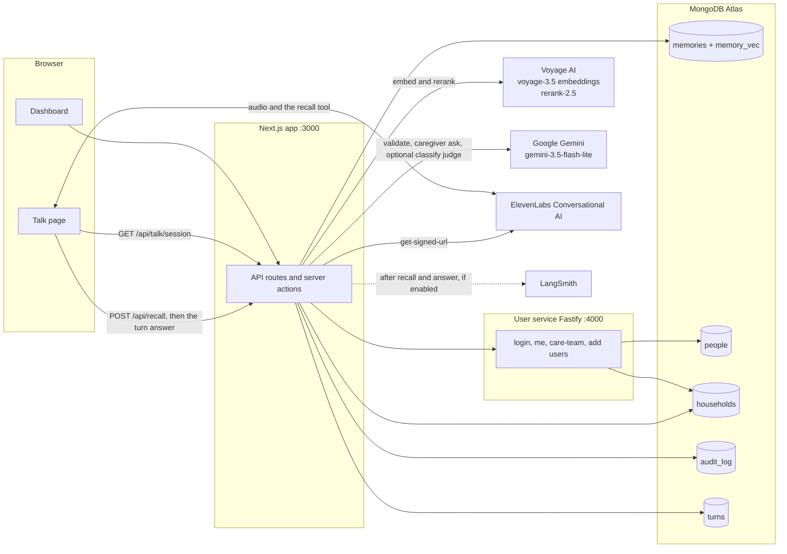
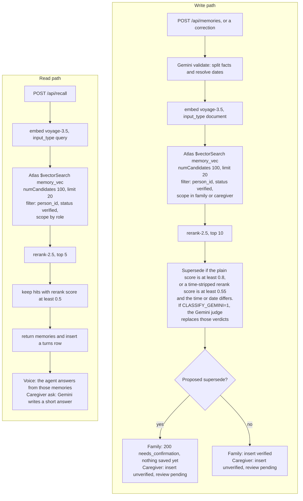

# Keepsake architecture

Verified against `origin/main` @ ba227c9 (14 Nov 2026). Line numbers point at that commit.

## Integrations

Which process calls which. The Next.js app is the only service that talks to Voyage, Gemini, ElevenLabs and LangSmith.

Notes:
- The browser never calls the user service. Next does, through `client/lib/userService.ts` (default `http://127.0.0.1:4000`). Login is a server action that sets the `keepsake_session` cookie (`client/app/login/actions.ts`).
- Dashboard covers family review and memory lists, plus the caregiver briefing and "Ask about …" box (`client/app/dashboard`). Family also has `/trace`. Login is `/login`.
- The ElevenLabs API key stays on the Next server in `client/app/api/talk/session/route.ts`. The Talk page gets a signed URL, then streams audio and tool calls to ElevenLabs directly (`client/app/talk/voice.tsx`). The agent's only tool, `recall`, runs in the browser and posts to `POST /api/recall` (not `/api/talk/recall`, which is gone). There is no `/api/talk/remember` route.
- Gemini (`gemini-3.5-flash-lite`, overridable with `GEMINI_MODEL`) and Voyage (`voyage-3.5`, `rerank-2.5`) keys are also read only on the Next server (`client/lib/gemini.ts:7`, `client/lib/voyage.ts:4-5`).
- LangSmith is wired in `client/lib/tracing.ts`. It is off unless `LANGSMITH_TRACING=true` and `LANGSMITH_API_KEY` are set. `POST /api/recall` posts a recall trace after the response (`client/app/api/recall/route.ts`, Next `after()`). The spoken or written answer is traced from `POST /api/turns/:id/answer` once the text has settled.
- The caregiver briefing is a plain `find` of verified memories, grouped by date. It does not call Voyage or Gemini (`client/lib/briefing.ts:6-7,56-61`).
- Atlas `memory_vec` is a vectorSearch index on `memories.embedding` (1024 dims, cosine) with filter fields `person_id`, `scope` and `status` (`db/vector_index.json`).
- Write and list API routes (`client/lib/api.ts:7`) and most pages trust role and `person_id` from the session JWT (`getSession` / `requireSession`). `POST /api/recall`, `/api/talk/session`, the turns routes, and the caregiver ask action re-read name, role and `person_id` from `households.members` (`getMemberSession` in `client/lib/auth.ts:36-45`). The user service re-reads membership on every authenticated request (`backend/src/auth.ts`). That split does not match SPEC R1, which says every request re-reads the role.

## Read and write flow

How a note is embedded and checked for a supersede, and how a question is searched and reranked.

Notes:
- Validate runs first, before any embed (`client/lib/validate.ts`, called from `createMemory` in `client/lib/writes.ts:235`). It splits the note into at most 10 facts and resolves relative dates in `America/Toronto`. Empty or over-500-character text returns 400 with no Gemini call. A confirm resend of a multi-fact note sends a signed `facts_token` and skips the Gemini split. Dates more than about six months from today, when the note gave no year, are shifted in code (`fixYears` in `client/lib/validate.ts:113-122`).
- Classify embeds each fact as a document and reuses that vector on insert (`client/lib/classify.ts:76,124`, `client/lib/writes.ts:198`). It always searches verified family and caregiver memories for that person, regardless of the writer's role (`client/lib/classify.ts:79-81`). What the writer is shown is then filtered to their readable scopes (`client/lib/writes.ts:168-176`).
- Vector search uses `numCandidates` 100 and `limit` 20 (`client/lib/classify.ts:29-30`, `client/lib/recall.ts:14-15`). The index filter fields are `person_id`, `status` and `scope`.
- Write-side rerank keeps the top 10 (`MAX_CANDIDATES` in `client/lib/classify.ts:31,87`). A memory supersedes if the plain `rerank-2.5` score is at least `SUPERSEDE_CUTOFF` 0.8 (`client/lib/classify.ts:17,90`). When the new note has a time or date, classify reranks again with times and dates replaced by placeholders (`client/lib/strip-times.ts`). A stripped score at or above `STRIPPED_CUTOFF` 0.55, plus a different time, date or `event_start`, also counts as a supersede (`client/lib/classify.ts:25,93-106`). Both checks are on by default. `CLASSIFY_GEMINI=1` turns on a Gemini judge that, if it succeeds, *replaces* the cutoff verdicts rather than adding to them (`client/lib/classify.ts:27,108-115`). It is off by default.
- Family: a proposed supersede returns 200 and saves nothing until `confirm: true` with the matching id, which re-runs classify. A mismatch is 409 with a fresh payload. A caregiver add always inserts `unverified` with `review.state: pending`, even when classify proposed a supersede (`client/lib/writes.ts:202-206,250`). Family then confirm or deny in the review queue. A Voyage failure after retries is 503 and nothing is saved (`client/lib/writes.ts:158`, `withRetry` in `client/lib/voyage.ts:51-70`).
- Corrections (`POST /api/memories/:id/corrections`, family only) still run validate and embed, but skip classify and always ask to supersede `:id`. The new memory inherits the old memory's scope.
- Read-side search is one function, `recall()`, behind `POST /api/recall` (`client/app/api/recall/route.ts`, `client/lib/recall.ts:96`). Margaret's voice agent, the caregiver ask box, and any signed-in household member all use it. Scopes are applied inside the `$vectorSearch` filter: person and family read `family` and `caregiver`; caregiver reads `caregiver` only (`readableScopes` in `client/lib/recall.ts:18-19,37`). Status is `verified` only (`client/lib/recall.ts:35-37`). This matches SPEC D-A1 / R16 as now written in `docs/specs/DECISIONS.md`, not the older "verified plus unverified" line in `docs/specs/WORKSPLIT.md`.
- Read-side rerank keeps the top 5 (`client/lib/recall.ts:16,64`), then drops hits below `MIN_RERANK_SCORE` 0.5 (`client/lib/recall.ts:10,91-92`). If rerank fails, recall falls back to vector order with `MIN_VECTOR_SCORE` 0.7 and at most 5 hits (`client/lib/recall.ts:66-72`). If the vector index is missing, it falls back to a keyword `find`. An embed failure returns no memories. Recall does not retry Voyage (voice has to stay fast). Kept memories and scores are written to `turns`. The voice prompt says to answer only from those memories (`client/lib/prompt.ts`). The caregiver ask box then has Gemini write one or two sentences from the same list, or a fixed "I don't have that written down" line if nothing passed the cutoff (`client/lib/ask.ts:44-50`).

## Roles

Three roles, stored on `households.members`. Readable scopes are in `client/lib/memories.ts:9-13`, with `private` stripped before any search (`client/lib/recall.ts:18-19`).

- **Family** (Anna, admin; David is also in the seed household). Add memories, saved `verified`, or after an "Are you sure?" when classify proposes a supersede. Correct and forget memories, see the review queue, and confirm or deny pending caregiver notes. Read family and caregiver scope. Can call `POST /api/recall`. Can view `/trace`. A family admin can add household members (`POST /users` on the user service).
- **Caregiver** (Ravi). Add notes only: always `caregiver` scope, always `unverified`, waiting for family review. The dashboard briefing and ask box, and `POST /api/recall`, search verified caregiver-scope memories. The notes list and `GET /api/memories` show only that caregiver's own notes (`client/lib/writes.ts:423-432`). Correct, review, forget, the review queue and `/trace` return 403.
- **Person** (Margaret). Uses the Talk page only. The voice agent calls `POST /api/recall` and receives verified family and caregiver memories. She cannot add, list or review memories (403). The agent cannot save what she says. It suggests telling family (`client/lib/prompt.ts:18`).
