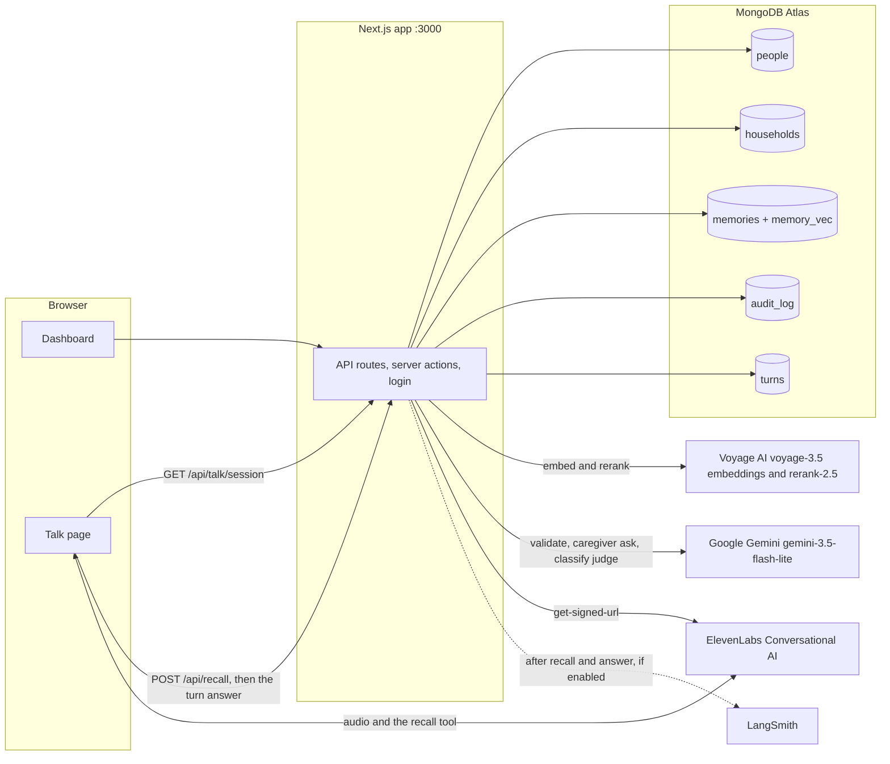
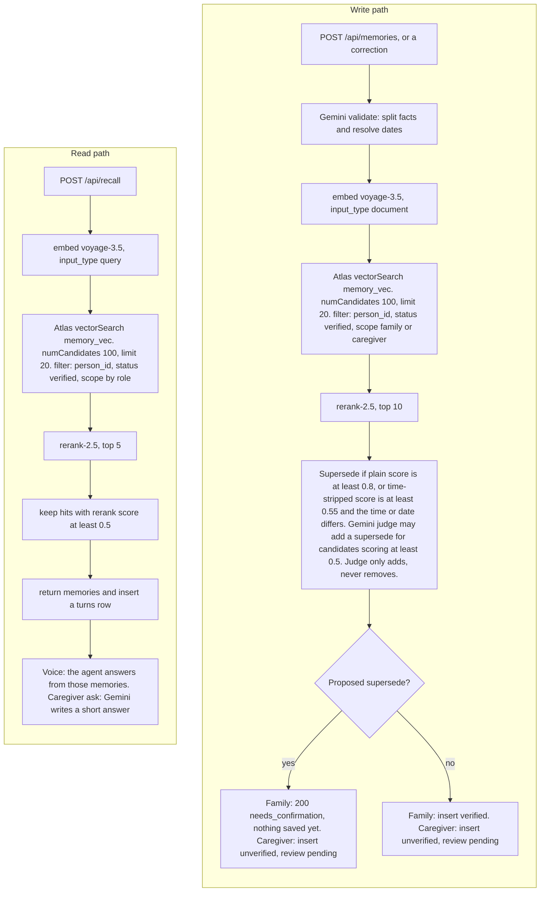

# Keepsake architecture

Verified against `origin/main` @ c40574c (14 Nov 2026). File names point at that commit.

## Integrations

Which process calls which. The Next.js app is the only service. Login, memory writes, recall and traces all run there.

Notes:

- Login is a server action that sets the `keepsake_session` cookie (`client/app/login/actions.ts`, `client/lib/users.ts`). There is no separate user service and no `:4000`. The old Fastify `backend/` was folded into this app.
- The cookie is trusted for `user_id` only. Name, role and `person_id` are re-read from `households.members` on every request (`getMemberSession` / `requireSession` in `client/lib/auth.ts`).
- Dashboard covers family review and memory lists, plus the caregiver briefing and "Ask about" box (`client/app/dashboard`). Family also has `/trace`. Login is `/login`.
- The ElevenLabs API key stays on the Next server (`client/app/api/talk/session/route.ts`). The Talk page gets a signed URL, then streams audio and tool calls to ElevenLabs (`client/app/talk/voice.tsx`). The agent's only tool, `recall`, runs in the browser and posts to `POST /api/recall`. There is no `/api/talk/recall` or `/api/talk/remember`.
- Gemini (`gemini-3.5-flash-lite`, overridable with `GEMINI_MODEL`) and Voyage (`voyage-3.5`, `rerank-2.5`) keys are read only on the Next server (`client/lib/gemini.ts`, `client/lib/voyage.ts`).
- LangSmith is wired in `client/lib/tracing.ts`. It is off unless `LANGSMITH_TRACING=true` and `LANGSMITH_API_KEY` are set. `POST /api/recall` posts a recall trace after the response. The spoken or written answer is traced from `POST /api/turns/:id/answer` once the text has settled.
- The caregiver briefing is a plain `find` of verified memories, grouped by date. It does not call Voyage or Gemini (`client/lib/briefing.ts`).
- Atlas `memory_vec` is a vectorSearch index on `memories.embedding` (1024 dims, cosine) with filter fields `person_id`, `scope` and `status` (`db/vector_index.json`).
- Family admin member management (`POST /users`) was dropped with the user service and has not been rebuilt. See Next steps in the root README.

## Read and write flow

How a note is embedded and checked for a supersede, and how a question is searched and reranked.

Rerank-2.5 scores how relevant a candidate is to the new note or question, not whether two notes contradict. That is why a reschedule of the same event scores high, and why a denial such as "has no grandkids" against "has two grandchildren" can sit under the 0.8 cutoff (0.648 on that pair) and needs the Gemini judge. A later PR branch, `fix/classify-contradiction` (`ce2e0f8`), lowers the judge floor to 0.4 and counts implied contradictions such as "has no kids". That is not on `main` yet.

Notes:

- Validate runs first, before any embed (`client/lib/validate.ts`, called from `createMemory` in `client/lib/writes.ts`). It splits the note into at most 10 facts and resolves relative dates in `America/Toronto`. Empty or over-500-character text returns 400 with no Gemini call. A confirm resend of a multi-fact note sends a signed `facts_token` and skips the Gemini split. Dates more than about six months from today, when the note gave no year, are shifted in code (`fixYears` in `client/lib/validate.ts`).
- Classify embeds each fact as a document and reuses that vector on insert (`client/lib/classify.ts`, `client/lib/writes.ts`). It always searches verified family and caregiver memories for that person, regardless of the writer's role. What the writer is shown is then filtered to their readable scopes.
- Vector search uses `numCandidates` 100 and `limit` 20. The index filter fields are `person_id`, `status` and `scope`.
- Write-side rerank keeps the top 10 (`MAX_CANDIDATES`). A memory supersedes if the plain `rerank-2.5` score is at least `SUPERSEDE_CUTOFF` 0.8. When the new note has a time or date, classify reranks again with times and dates replaced by placeholders (`client/lib/strip-times.ts`). A stripped score at or above `STRIPPED_CUTOFF` 0.55, plus a different time, date or `event_start`, also counts as a supersede. Both checks are on by default. The Gemini judge is also on by default (`CLASSIFY_GEMINI=0` turns it off). It only looks at candidates scoring at least `JUDGE_MIN` 0.5 that the rules did not already mark, and it can only add a supersede, never remove one (`client/lib/classify.ts`).
- Family: a proposed supersede returns 200 and saves nothing until `confirm: true` with the matching id, which re-runs classify. A mismatch is 409 with a fresh payload. A caregiver add always inserts `unverified` with `review.state: pending`, even when classify proposed a supersede. Family then confirm or deny in the review queue. A Voyage failure after retries is 503 and nothing is saved (`withRetry` in `client/lib/voyage.ts`).
- Corrections (`POST /api/memories/:id/corrections`, family only) still run validate and embed, but skip classify and always ask to supersede `:id`. The new memory inherits the old memory's scope.
- Read-side search is one function, `recall()`, behind `POST /api/recall` (`client/app/api/recall/route.ts`, `client/lib/recall.ts`). The voice agent, the caregiver ask box, and any signed-in household member all use it. Scopes are applied inside the `$vectorSearch` filter: person and family read `family` and `caregiver`; caregiver reads `caregiver` only. Status is `verified` only. This matches SPEC D-A1.
- Read-side rerank keeps the top 5, then drops hits below `MIN_RERANK_SCORE` 0.5. If rerank fails, recall falls back to vector order with `MIN_VECTOR_SCORE` 0.7 and at most 5 hits. If the vector index is missing, it falls back to a keyword `find`. An embed failure returns no memories. Recall does not retry Voyage (voice has to stay fast). Kept memories and scores are written to `turns`. The voice prompt says to answer only from those memories (`client/lib/prompt.ts`). The caregiver ask box then has Gemini write one or two sentences from the same list, or a fixed "I don't have that written down" line if nothing passed the cutoff (`client/lib/ask.ts`).

## Roles

Three roles, stored on `households.members`. Readable scopes are in `client/lib/memories.ts`. There is no `private` scope.

- **Family** (Anna is admin in the seed; David is also in the household). Add memories, saved `verified`, or after an "Are you sure?" when classify proposes a supersede. Correct and forget memories, see the review queue, and confirm or deny pending caregiver notes. Read family and caregiver scope. Can call `POST /api/recall`. Can view `/trace`. Adding or removing household members is not built.
- **Caregiver** (Ravi in the seed). Add notes only: always `caregiver` scope, always `unverified`, waiting for family review. The dashboard briefing and ask box, and `POST /api/recall`, search verified caregiver-scope memories. The notes list and `GET /api/memories` show only that caregiver's own notes. Correct, review, forget, the review queue and `/trace` return 403.
- **Person** (Margaret in the seed). Uses the Talk page only. The voice agent calls `POST /api/recall` and receives verified family and caregiver memories. She cannot add, list or review memories (403). The agent cannot save what she says. It suggests telling family (`client/lib/prompt.ts`).
