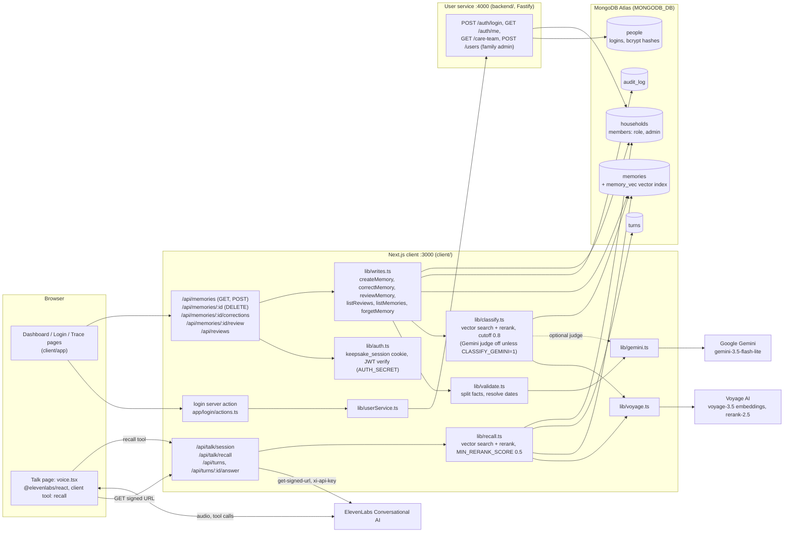

# Keepsake architecture

Drawn from the code on branch `feat/write-validate` @ b5f8ccd (Nov 14, 2026). Anything not read directly from the code is marked *(inferred)*.

## Components



Notes:
- The browser never calls the user service; the Next server calls it (`lib/userService.ts`, default `http://127.0.0.1:4000`).
- The ElevenLabs API key is read only by the Next client, in `app/api/talk/session/route.ts` (`ELEVENLABS_API_KEY`, `ELEVENLABS_AGENT_ID`). The backend does not use it. The browser gets a signed URL and talks to ElevenLabs directly; the agent's `recall` tool runs in the browser and calls `/api/talk/recall`.
- The Gemini key (`GEMINI_API_KEY`) and Voyage key are read only on the Next server.
- `app/api/talk/remember/route.ts` still exists in the code but is not wired to the voice agent (A16); it is left out of the diagram.

## Write path

```mermaid
sequenceDiagram
  autonumber
  actor W as Writer (Anna family / Ravi caregiver)
  participant API as POST /api/memories
  participant WR as lib/writes.ts
  participant V as validate.ts
  participant G as Gemini
  participant C as classify.ts
  participant VY as Voyage
  participant DB as Atlas memories + audit_log
  actor F as Family reviewer (Anna)

  W->>API: {text, scope}
  API->>WR: createMemory(session, input)
  WR->>WR: role check (family or caregiver, else 403)<br/>scope: caregiver forced for caregivers
  WR->>V: validate(text)
  V->>V: empty / >500 chars -> 400 (no Gemini)
  V->>G: split into facts, resolve relative dates
  G-->>V: facts[{text, event_start?, event_end?}]
  loop each fact
    WR->>C: classify(fact)
    C->>VY: embed (voyage-3.5, document)
    C->>DB: $vectorSearch memory_vec<br/>(verified, family+caregiver scopes)
    C->>VY: rerank-2.5 top 10
    C-->>WR: candidates, supersedes = score >= 0.8
  end
  Note over WR,VY: Voyage error -> 503 unavailable, nothing saved

  alt Caregiver writer
    WR->>DB: insert unverified, flagged, review pending + audit write
    WR-->>W: 201 needs_family_review (proposal hidden if not readable)
  else Family, no supersede proposed
    WR->>DB: insert verified + audit write (one transaction)
    WR-->>W: 201 saved
  else Family, supersede proposed
    WR-->>W: 200 needs_confirmation (single fact)<br/>or batch saved:false + facts_token (multi-fact)
    W->>API: confirm:true + confirm_supersedes<br/>(batch: facts[] + facts_token, no text)
    API->>WR: createMemory (facts_token HMAC checked, else 400; no Gemini)
    WR->>C: classify again
    alt still proposes the same old memory
      WR->>DB: transaction: old -> superseded, new verified,<br/>review approved, audit approve
      WR-->>W: 201 saved
    else proposes a different memory
      WR-->>W: 409 fresh needs_confirmation
    end
  end

  F->>API: GET /api/reviews (family only)
  API-->>F: pending items with "This will supersede <old>"
  alt confirm
    F->>WR: POST /api/memories/:id/review {decision: confirm}
    WR->>DB: transaction: new verified, old superseded if still verified,<br/>audit approve (or verify if no proposal)
  else deny
    F->>WR: POST /api/memories/:id/review {decision: deny}
    WR->>DB: new retracted, old untouched, audit deny
  end
  Note over F,DB: Deciding an already-decided review -> 409
```

Corrections (`POST /api/memories/:id/corrections`, family only) follow the same validate step, skip classify, and always ask to supersede `:id`; the confirm resend saves the new memory with the old memory's scope.

## Roles

Each request's role comes from the session JWT (`client/lib/auth.ts`). The user service issues that JWT at login after checking `people` and `households.members`.

- **Family** (Anna, David). Add memories (saved verified, or after an "Are you sure?" when they would replace one), correct and forget memories, see the review queue and confirm or deny pending notes. Reads family and caregiver scope. A family admin (Anna) can also add household members through the user service (`POST /users`).
- **Caregiver** (Ravi). Add memories only. Every caregiver note is saved unverified in caregiver scope and waits for family review. Reads caregiver scope only, and in lists sees only their own notes. Correct, review, forget and the review queue return 403.
- **Person** (Margaret). Talks to the voice agent, which recalls her memories through `/api/talk/recall` (family and caregiver scope, verified memories only: `lib/recall.ts:36`). Cannot add, list or review memories (403).
